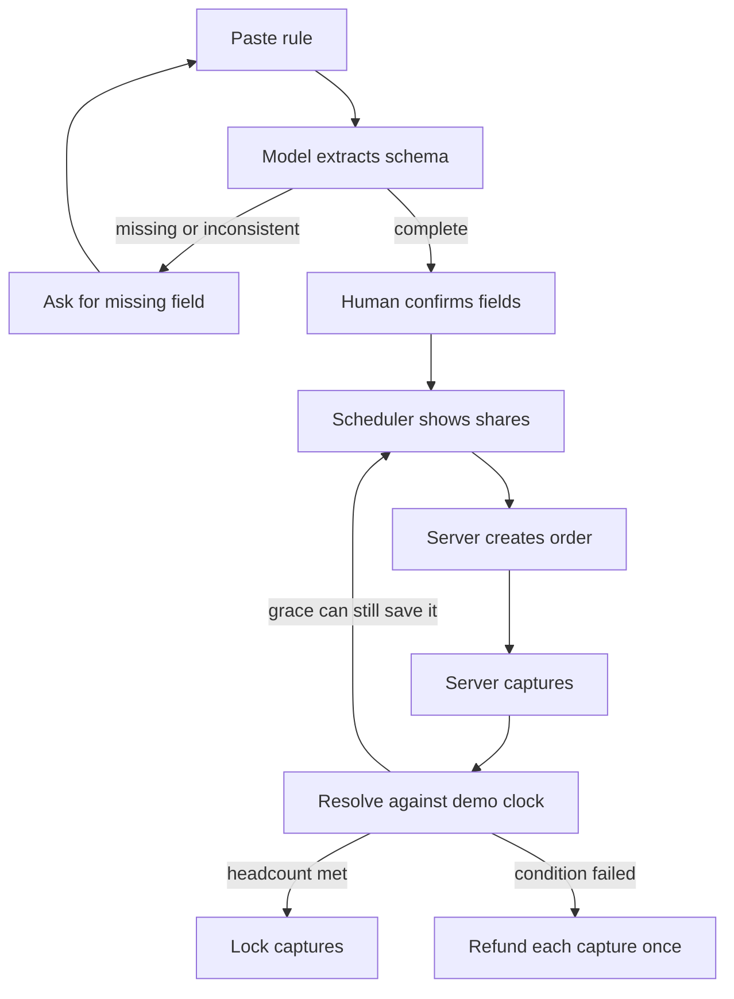
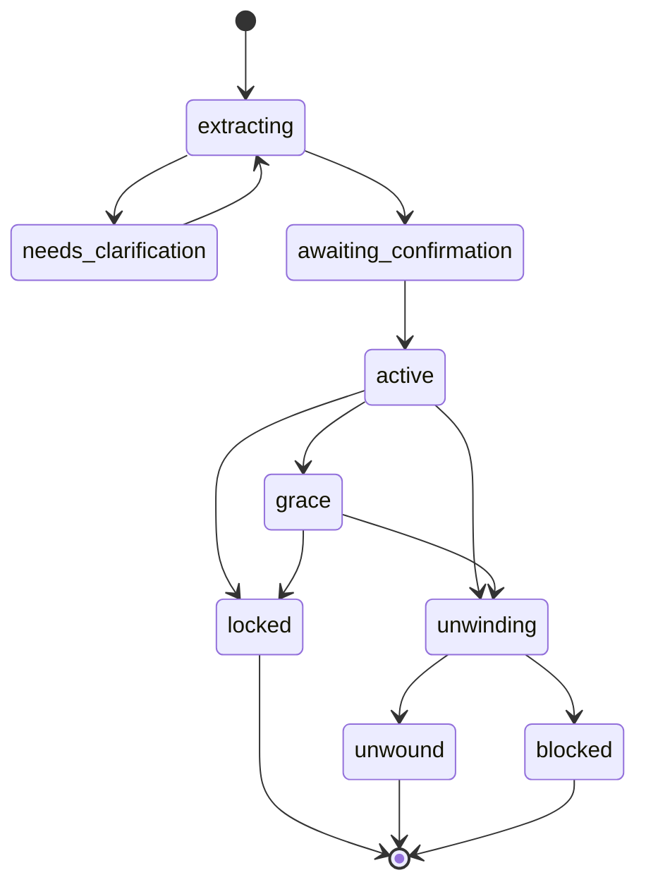

# Architecture

Foldback is one React app and one Node API. The API is the only component allowed to talk to PayPal or the model. The browser renders server state and sends intents.

## Stack

| Piece | Choice | Notes |
|---|---|---|
| UI | React 18, TypeScript, Vite | Three screens in `ui.md` |
| Schedule | `@bryntum/scheduler` trial package | One Scheduler. See `scheduler.md` |
| API | Node 20, Express, TypeScript | `app/server` |
| DB | SQLite via `better-sqlite3` | File at `app/data/foldback.sqlite`, gitignored |
| Model | One OpenAI-compatible chat completion with JSON schema | Called only from `POST /api/contracts` |
| PayPal | REST on `https://api-m.sandbox.paypal.com` | Orders v2 and Payments v2 refunds. No SDK required |
| Tests | Vitest for the engine and HTTP handlers | Cases are listed in `test.md` |
| License | MIT for original code | Added in phase 7 |

Do not add a second database, a queue, Redis, Docker, or a sponsor tool. The demo clock replaces a job runner. `POST /api/contracts/:id/resolve` evaluates the rule when the organizer moves the clock or presses Resolve.

## Processes

```text
browser (Vite :5173)
  |  /api proxied to Express :8787
Express
  |-- sqlite
  |-- PayPal sandbox
  \-- LLM HTTP API
```

Vite dev server proxies `/api` to `http://127.0.0.1:8787`. Production demo, if hosted, serves the built client from Express. Phase 7 may use any host that is not an official hackathon sponsor. A judge-run local README is enough if hosting slips.

## Modules

```text
app/server/src/
  index.ts                 listen, JSON body, error handler
  db.ts                    open sqlite, migrate
  routes/contracts.ts
  routes/shares.ts
  routes/demo.ts
  engine/extract.ts        calls the model, validates schema
  engine/confirm.ts        checks the human-confirmed payload
  engine/resolve.ts        lock, grace, or unwind from demo_now
  engine/money.ts          cents math only
  paypal/client.ts         oauth, order, capture, refund, get
  paypal/ops.ts            idempotency rows and unknown outcomes
  seed.ts                  sample contracts
app/client/src/
  screens/RuleScreen.tsx
  screens/BoardScreen.tsx
  screens/CheckoutScreen.tsx
  api.ts
  scheduler/FoldbackScheduler.tsx
app/shared/src/
  statuses.ts
  types.ts
```

Phase files say which of these files to create. Do not create a file early because it "will be needed later," except the shared status enums, which phase 1 needs.

## Request flow



## Money state machine

Contract status is one of:

`extracting`, `needs_clarification`, `awaiting_confirmation`, `active`, `grace`, `locked`, `unwinding`, `unwound`, `blocked`.

Share status is one of:

`waiting`, `checkout_open`, `capture_unknown`, `captured`, `locked`, `refund_pending`, `refund_unknown`, `refunded`, `expired`, `declined`.

There is no share status called `grace`. Grace is a contract status. The grace person stays `waiting` or `checkout_open` and is the only share allowed to start checkout while the contract is `grace`.



Allowed transitions are only the arrows above. `locked`, `unwound`, and `blocked` are terminal for money actions. Reset deletes the local database; it is not a transition.

### Resolve rules

`resolve` reads `demo_now`, the confirmed deadline, the grace window, and shares whose status is `captured` or `locked`. `capture_unknown` and `refund_unknown` block resolve: the contract becomes `blocked` and the API returns `409 money_unknown`. Do not lock or refund while any share is unknown.

Let `paid` be the count of shares in `captured` or `locked`. Let `needed` be `headcount`. Let `graceSlot` be 1 only when all of these are true: a grace person is confirmed, that share is not paid, `demo_now` is greater than or equal to `deadline_at`, and `demo_now` is less than `grace_until`. Otherwise `graceSlot` is 0.

At `demo_now < deadline_at`:

- If `paid >= needed`, set contract `locked` and every `captured` share to `locked`.
- Otherwise stay `active`. Checkout remains open for `waiting` shares.

At `demo_now >= deadline_at`:

- If `paid >= needed`, lock as above.
- Else if `paid + graceSlot >= needed`, set contract `grace`. Checkout stays open only for the grace person's `waiting` share. Every other `waiting` or `checkout_open` share becomes `expired`. A `checkout_open` order for an expired share is not captured later; capture returns `409 share_not_payable`.
- Else start unwind.

Unwinding:

- Contract status `unwinding`.
- Each `captured` share is refunded with the idempotency key in `paypal.md`.
- On refund `COMPLETED`, share becomes `refunded`.
- On timeout or an unreadable body, share becomes `refund_unknown` and contract becomes `blocked` after the loop stops. Shares already `refunded` stay `refunded`. Do not refund the unknown share again until `sync` finds a terminal PayPal status.
- When every previously captured share is `refunded` and none are unknown, contract becomes `unwound`.
- Shares that never captured become `expired` during unwind. They are not refunded.

A locked contract rejects checkout, capture, and refund with `409 contract_locked`.

## Invariants

- Amounts are integer cents. PayPal string amounts are formatted only inside `paypal/client.ts` as two decimal places.
- `share.amount_cents` is copied from `contract.share_cents` at confirm time and never edited.
- One live order per share. A share in `checkout_open`, `capture_unknown`, `captured`, `locked`, `refund_pending`, `refund_unknown`, or `refunded` cannot start a new order.
- One refund per capture. The refund idempotency key is stable for the life of the share.
- The browser never sends an amount, a capture id to trust, or a refund id to create. Capture and refund ids are written only by the server from PayPal's response.
- `money_source = sample` shares have null PayPal ids. Checkout and refund against them return `409 sample_row`.

## Failure behavior

| Situation | Stored result | What the user sees |
|---|---|---|
| Model output fails schema | `needs_clarification` | The question "I could not read a complete rule. Restate the price, headcount, and deadline." |
| Buyer closes checkout | share `declined` if we learn it, else stays `checkout_open` until sync | "Checkout not finished." |
| Capture HTTP timeout | `capture_unknown` | "Payment result unknown. This share stays reserved." |
| Capture `COMPLETED` | `captured` plus capture id | "Paid" and the capture id |
| Refund HTTP timeout | `refund_unknown`, contract `blocked` | "Refund result unknown. No second refund was sent." |
| Refund `COMPLETED` | `refunded` plus refund id | "Refunded" and the refund id |
| Resolve while any unknown exists | contract `blocked` | "Resolve is paused until the unknown PayPal call is checked." |

`sync` calls PayPal `GET` for the stored order, capture, or refund id. It is the only way out of `capture_unknown` or `refund_unknown`. If PayPal shows the capture completed, store it and continue. If PayPal shows no capture, return the share to `waiting` only when the order is `VOIDED`, `CREATED` past expiry, or `COMPLETED` with no capture unit. If the GET itself fails, stay unknown.

## Security boundaries for the prototype

- PayPal secret and the model key stay in server environment variables.
- The client receives an approval URL, not the secret.
- CORS is unnecessary while the Vite proxy is used. If the API is exposed for a hosted demo, allow only the demo origin.
- There is no login. Anyone who can open the demo can reset it. That is acceptable for a sandbox judge build and must be stated in `app/README.md`.
- Do not log full PayPal access tokens.

## Out of process

No webhooks in the MVP. Sandbox return URLs hit the Checkout screen, which calls the capture route. The demo clock is manual. Both choices are deliberate so a judge can run the app without a public callback URL.
