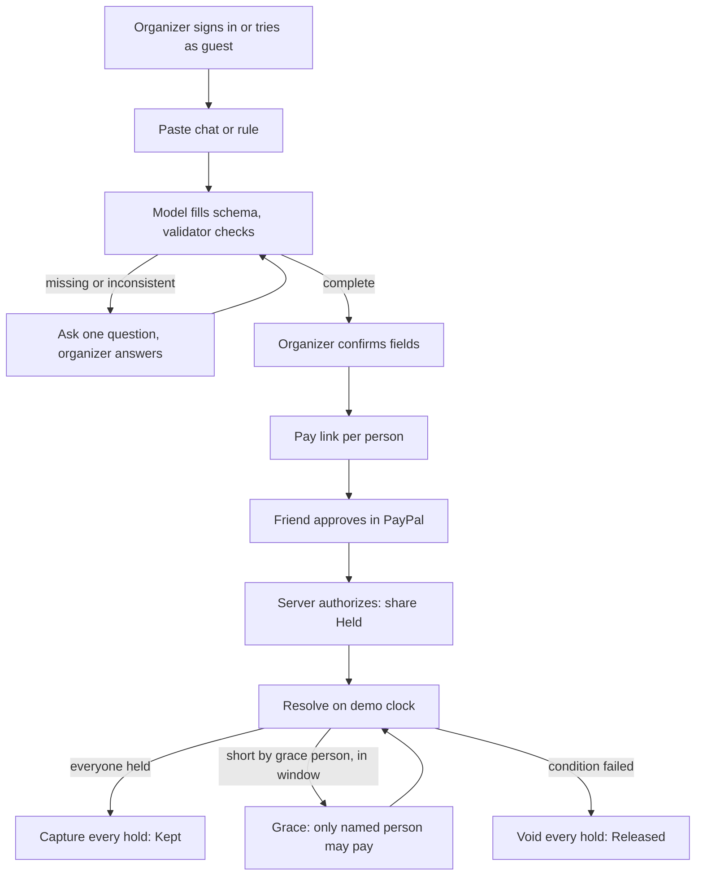
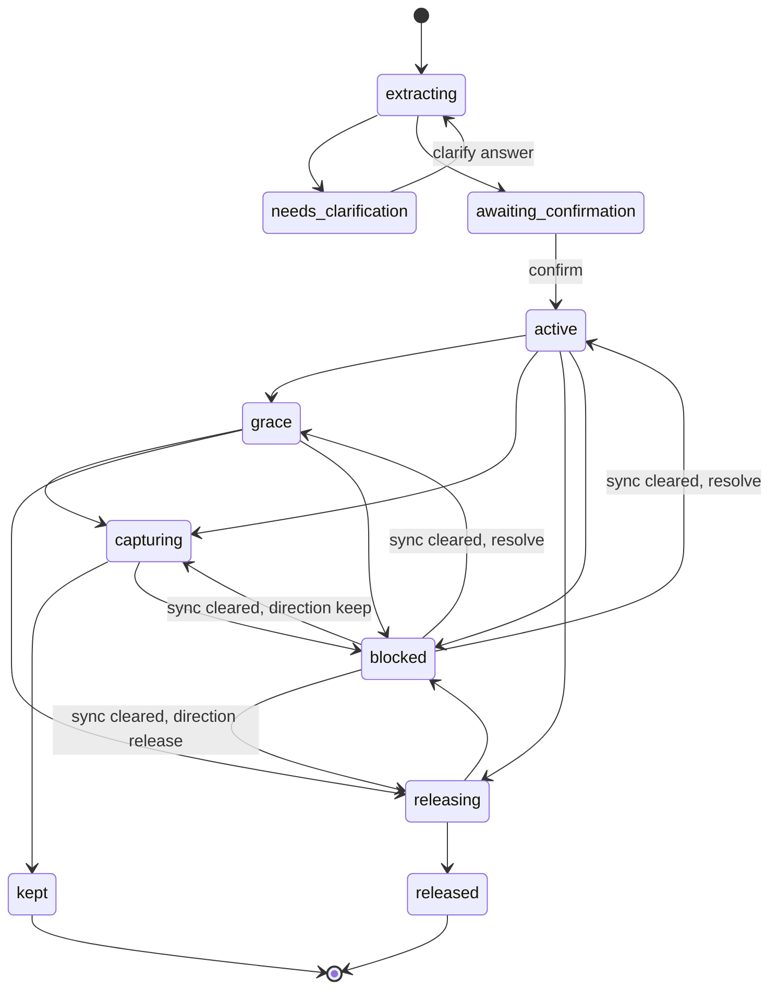

# Architecture

Foldback is a Next.js frontend and an Express API, deployed as two containers behind Caddy on one VM, with Postgres alongside. The API is the only component that talks to PayPal, the LLM providers, or the database. The browser renders server state and sends intents.

## Stack

| Area | Choice |
|---|---|
| Language | TypeScript everywhere, `strict: true`. Backend TS ^6 (fall back to ^5.9 if a dependency's types break; record it), frontend TS ^5 |
| Runtime | Node.js 24 LTS (`node:24-bookworm-slim` images) |
| Package manager | Yarn 4 (Berry, via Corepack, `nodeLinker: node-modules`, `enableScripts: false` with a per-package allow-list), two separate packages (`backend/`, `frontend/`), each with its own `yarn.lock`. Not a monorepo |
| API | Express 5 (^5.2), compiled by `tsc` to `dist/` and run with plain `node` in production. `tsx` watch in dev |
| Realtime | Socket.IO 4 (^4.8). Used only to tell clients "this contract changed" |
| Database | PostgreSQL 16 **hosted separately from the app** (Azure Database for PostgreSQL Flexible Server, see `deploy.md`), with the plain `pg` driver. Two roles: an owner for migrations and a DML-only `foldback_app` for the running app. No ORM. Hand-written SQL. Numbered `.sql` migrations run by `src/cli/migrate.ts` (`migrate`, `status`, `reset`) |
| Validation | zod ^4 strict objects on every body, params, and query, and on env |
| Auth | JWT (`jsonwebtoken`) in an httpOnly cookie, bcrypt password hashing, email login, guest demo accounts |
| Security | helmet, cors allow-list (`CORS_ORIGINS`), express-rate-limit per IP and per user, `TRUST_PROXY`, Origin check on mutations |
| Logging | winston, JSON in production, child logger per module, correlation id per request via AsyncLocalStorage |
| Observability | prom-client `/metrics`, `/health/live`, `/health/ready`. OpenTelemetry (sdk-node, OTLP http, express/http/pg instrumentation), on only when `OTEL_EXPORTER_OTLP_ENDPOINT` is set |
| AI | Plain `fetch` to free OpenAI-compatible APIs: Gemini Flash models first, then Groq `gpt-oss-120b` and `gpt-oss-20b`, then OpenRouter free. No LLM SDK. See `ai.md` |
| PayPal | REST with `fetch` to `https://api-m.sandbox.paypal.com`. No SDK. See `paypal.md` |
| Dates | luxon (backend). `Intl` on the frontend |
| Frontend | Next.js 16 App Router, React 19.2, MUI 7 + Emotion (`@mui/material-nextjs` for App Router SSR), design tokens in `src/theme`. **Dev and build use webpack:** the scripts are `next dev --webpack` and `next build --webpack`, because Turbopack's dev server dies while compiling the Bryntum package (found in phase 0, on a laptop and in Codespaces) |
| Frontend state | Redux Toolkit 2 + react-redux 9, RTK Query API layer in `src/api` |
| Schedule | Bryntum Scheduler trial + React wrapper, rendered client-only. See `scheduler.md` |
| Tests | Jest 30 + ts-jest + supertest. Integration tests use a real Postgres test database. See `test.md` |
| Lint | ESLint 9 flat config (`eslint-config-next` on the frontend, `typescript-eslint` on the backend) |
| CI | GitHub Actions: typecheck, lint, and test for both packages, then build and push images to ghcr.io on `main` |
| Deploy | Multi-stage Dockerfiles, Docker Compose on one Azure VM (x64), Azure Database for PostgreSQL Flexible Server for data, Caddy 2 for TLS. See `deploy.md` |

Not used, even though our previous project had them: worker_threads, Groq, market-data libraries, charting packages, Google sign-in, username login, autoscaling scripts. Nothing here needs them.

## Processes

```text
                Internet (HTTPS 443)
                        |
                     Caddy 2  ── automatic TLS, HTTP→HTTPS, WebSocket proxy
              /api/*, /socket.io/*, /health/*      everything else
                 |                                     |
          backend :8787 (Express 5 + Socket.IO)   frontend :3000 (Next.js standalone)
           |        |          |
     Postgres 16  PayPal     Gemini, Groq
     (managed,    sandbox    LLM APIs
      separate)
```

One domain serves both, so the auth cookie is first-party, there are no cross-origin requests in production, and PayPal return URLs are simple. `/metrics` is not exposed publicly by Caddy. It is reachable only inside the Compose network, or with `METRICS_TOKEN`.

The database is a separate service, reached only through `DATABASE_URL`, so the backend container is stateless and can be replaced or duplicated. We still run **one** backend instance for now. Running more needs two small changes, both behind existing interfaces: a shared store for rate-limit counters, and a Redis adapter for Socket.IO rooms. Everything that must be correct across instances is already in Postgres (advisory locks, unique indexes, the guard triggers). Housekeeping jobs (guest cleanup) are safe on every instance because they are idempotent.

## Backend layout and layering

```text
backend/
  package.json  yarn.lock  tsconfig.json  tsconfig.build.json  jest.config.ts  eslint.config.mjs  Dockerfile  .env.example
  docs/principles.md               engineering principles (phase 1)
  migrations/0001_init.sql …       numbered, forward-only
  src/cli/migrate.ts, housekeeping.ts   compiled into the image (node dist/cli/migrate.js migrate); migrate | status | reset (reset refuses when NODE_ENV=production)
  scripts/sync-types.ts            copies src/shared/* into frontend/src/types/generated/
  src/
    server.ts                      boot: env → otel → pool → migrations check → http + io → graceful shutdown
    app.ts                         express app factory (tests mount it without listening)
    config/env.ts                  zod-validated env, fail fast
    observability/                 logger.ts, requestContext.ts, metrics.ts, otel.ts
    db/                            pool.ts, tx.ts (withTransaction, withContractLock), migrator.ts (used by cli/migrate.ts and /health/ready)
    http/                          errors.ts (AppError), middleware/ (requestId, auth, originCheck, rateLimit, validate, errorHandler)
    routes/                        health, auth, contracts, shares, agent, demo (*.routes.ts: paths + middleware only)
    controllers/                   parse validated input, call one service, shape the response
    services/                      business logic and transactions (auth, contracts, extract, confirm, holds, resolve, sync, agent, seed, aiBudget, projection)
    repositories/                  SQL only (users, contracts, shares, operations, events, aiUsage)
    domain/                        PURE code: statuses, decide, payable, reason, money, time, validateExtraction
    integrations/paypal/           client.ts (token cache, request + classification), keys.ts
    integrations/llm/              client.ts, extractPrompt.ts, agentTools.ts, agentRunner.ts
    realtime/                      io.ts (auth handshake, rooms), notify.ts (emit after commit)
    shared/                        api-types.ts, statuses.ts. Source of truth for the frontend copy
  test/unit/  test/integration/  test/fixtures/
```

Layering rules:

- `routes → controllers → services → repositories → db`. A layer may only call the one below it. `domain/` is pure, and anything may import it. `integrations/` is called only by services.
- **Every money mutation happens in exactly one service function**, inside `withTransaction` (and `withContractLock` for anything that can capture or void).
- Repositories take a `PoolClient` so services control transaction boundaries.
- Controllers never import `pg`, PayPal, or an LLM provider.

### Why `domain/decide.ts` is pure

`decide(snapshot, now)` takes plain objects and a time and returns a decision: `stay_active`, `enter_grace`, `keep`, `release`, or `blocked`, plus the share changes it implies. `services/resolve` loads the real state, calls `decide`, and executes the PayPal calls. The agent's `simulate_outcome` tool calls the same `decide` on a copy. A simulation therefore cannot drift from the real rule, and it cannot move money. Pure code is also trivial to unit-test.

## Frontend layout

```text
frontend/
  package.json  yarn.lock  next.config.ts (output: "standalone")  tsconfig.json  eslint.config.mjs  jest.config.ts  Dockerfile
  src/app/                 routes: layout.tsx, (auth)/login, (auth)/signup, plans/, plans/[id]/, pay/[shareId]/
  src/features/            auth/, rules/, board/, assistant/, pay/   (UI + slice + logic per feature)
  src/components/          shared UI (StatusPill, MoneyText, EvidenceQuote, …)
  src/api/                 RTK Query baseApi + endpoint slices, tag invalidation
  src/sockets/             socket.io-client singleton, room join, tag invalidation on events
  src/store/               store.ts, hooks
  src/theme/               tokens and the MUI theme (from the phase 2 design)
  src/hooks/  src/lib/     format (money, dates), errors
  src/types/generated/     copied from backend/src/shared by `yarn sync-types`. Never edited by hand
```

Server components render the shell and static copy. Anything with data, auth, or Bryntum is a client component. Bryntum loads with `next/dynamic` and `ssr: false`.

Shared types: `backend/src/shared` is the single source of truth. `yarn sync-types` copies it into the frontend. CI runs the copy and fails if `git diff` is not empty, so the two packages cannot drift apart.

## Request flow



After every committed change, the service calls `realtime/notify` → `io.to("contract:{id}").emit("contract:changed", { contractId, version })` and `io.to("share:{id}").emit("share:changed", …)`. Clients respond by invalidating RTK Query tags and refetching. **Sockets carry invalidations, never state**, so the REST read model stays the only source of truth.

## Money state machine

### Contract status

`extracting`, `needs_clarification`, `awaiting_confirmation`, `active`, `grace`, `capturing`, `kept`, `releasing`, `released`, `blocked`.



Only these arrows are allowed, and a database trigger enforces them (see `data-model.md`). `kept` and `released` are terminal. `blocked` is a pause: once `sync` clears every unknown share, the next resolve continues. A definite PayPal capture refusal (`capture_failed`) leaves the contract `blocked` with a reason and no automatic way out.

### Direction

`direction` is `null`, `keep`, or `release`. Resolve sets it once, in the same transaction that moves the contract to `capturing` or `releasing`. A database trigger rejects any later change. A blocked contract with a direction resumes in that direction. This is what prevents "half captured, then the clock moved, then released the rest."

### Share status

`waiting`, `checkout_open`, `authorize_unknown`, `held`, `capture_unknown`, `kept`, `capture_failed`, `void_unknown`, `released`, `expired`, `declined`.

| Status | Meaning | PayPal ids present |
|---|---|---|
| `waiting` | No order yet, or a previous attempt failed before approval | none |
| `checkout_open` | Order created; buyer has the approval link | `order_id` (null only in the lost-create case) |
| `authorize_unknown` | Authorize sent; response lost | `order_id` |
| `held` | Authorization `CREATED`: on hold, not charged | `order_id`, `authorization_id` |
| `capture_unknown` | Capture sent; response lost | + `authorization_id` |
| `kept` | Captured | + `capture_id` |
| `capture_failed` | PayPal definitively refused the capture | + `authorization_id` |
| `void_unknown` | Void sent; response lost | + `authorization_id` |
| `released` | Authorization `VOIDED` or `EXPIRED`; nobody charged | + `authorization_id` |
| `expired` | Never held by the cutoff | maybe `order_id` |
| `declined` | Buyer cancelled at PayPal; may retry while payable | maybe `order_id` |

The unknown statuses are `authorize_unknown`, `capture_unknown`, and `void_unknown`. There is no share status `grace`; grace is a contract status.

### Resolve rules

Definitions:

- `held` = the count of shares in `held`.
- `needed` = `headcount` (people.length = headcount, so `held >= needed` means everyone).
- `graceOpen` = a grace person is confirmed, their share is not `held`, and `deadline_at <= demo_now < grace_until`.

Algorithm (`domain/decide`, executed by `services/resolve` under `withContractLock`):

1. `kept` or `released` → `409 contract_closed`.
2. Any unknown share → contract `blocked` (event `contract_blocked` once), `409 money_unknown`.
3. Any `capture_failed` → stays `blocked`, `409 capture_refused`.
4. `direction = keep` → capture wave. `direction = release` → release wave.
5. Otherwise:
   - `held >= needed` → set `direction = keep`, run the capture wave (before or after the deadline).
   - `demo_now < deadline_at` → `active`.
   - `graceOpen` and `held + 1 >= needed` → `grace`. Every non-grace share in `waiting`, `checkout_open`, or `declined` → `expired`.
   - Otherwise → set `direction = release`, run the release wave.

**Capture wave** (`capturing`): for each `held` share in id order, sample rows → `kept` locally, and sandbox rows → capture. `COMPLETED` → `kept` + `capture_id`. Unknown → `capture_unknown`, stop, `blocked`. Definite 4xx → GET order. If a capture exists, store it (replay). Otherwise `capture_failed`, stop, `blocked`. When every share is `kept`: contract `kept`, `resolved_at`, event `contract_kept`.

**Release wave** (`releasing`): `waiting`, `checkout_open`, and `declined` → `expired`. Each `held` share: sample → `released` locally; sandbox → void. 204/200 → `released`. Unknown → `void_unknown`, stop, `blocked`. Definite 4xx → GET authorization: `VOIDED` or `EXPIRED` → `released`, otherwise the share stays `held` and the contract `blocked`. When nothing is `held` or unknown: contract `released`, event `contract_released`.

The authorize that completes the headcount runs resolve in the same request (under the contract lock), so the fourth hold returns with share and contract both `kept`.

### Payable rule (`domain/payable`)

A share may start checkout or finish authorize only when:

- the contract is `active`, `direction` is null, the share is `waiting`, `checkout_open`, or `declined`, and `demo_now < deadline_at`; or
- the contract is `grace`, the share is the grace subject in `waiting`, `checkout_open`, or `declined`, and `demo_now < grace_until`.

Otherwise the route returns `409 share_not_payable` (or the more specific `contract_closed`, `sample_row`, `share_already_held`, or `money_unknown`). An approved order is not money until we authorize it, so refusing authorize after the cutoff leaves the buyer uncharged.

## Concurrency

- **Contract lock.** `withContractLock(contractId, fn)` takes `pg_try_advisory_lock(hashtextextended(contractId, 0))` on a dedicated pooled client for the whole of resolve, clock, and authorize, then releases it in `finally`. If the lock is busy, it returns `409 resolve_in_progress`. Two browser tabs pressing Resolve can never run two capture waves. The lock is session-level, so the same client must call `pg_advisory_unlock` in `finally` before it is released (a leaked lock would leave the contract "busy" until that connection dies). The authorize path takes the same lock. Inside each of transaction 1 and transaction 2, start with `SELECT 1 FROM contracts WHERE id = $1 FOR UPDATE`. Use a **direct** (not pooled) database connection, because transaction-mode poolers break session-level advisory locks.
- **One in-flight PayPal call per share.** A partial unique index on `paypal_operations(share_id) WHERE outcome IN ('pending','unknown')` makes a second concurrent mutating call fail at insert time, before any HTTP request is sent.
- **PayPal calls never run inside a database transaction.** The pattern is: tx 1 inserts a `pending` operation and changes the share status, then commits. Then the HTTP call. Then tx 2 records the outcome and the new status. A crash between tx 1 and tx 2 leaves a `pending` operation, which is treated as unknown.
- **Every recovery path reads from the database.** On boot, nothing is retried automatically. Unknowns wait for sync.

## Invariants

- Amounts are integer cents. PayPal decimal strings are formatted only in `integrations/paypal`.
- `share.amount_cents` is copied from `contract.share_cents` at confirm and never edited (trigger).
- A contract is entirely `sample` or entirely `sandbox`.
- At most one live order per share. One authorization, one capture, and one void per authorization. Idempotency keys are derived from the PayPal object (see `paypal.md`) and are UNIQUE in `paypal_operations`.
- `direction` is written once.
- The browser never sends an amount or a PayPal id to trust, except the `order_id` from the return URL, which must equal the stored one.
- The model never writes amounts, statuses, PayPal ids, or `resolution_reason`.
- An organizer can only read or change their own contracts. Payers reach a share only by its unguessable id.

## Security

- **Auth.** The JWT (HS256, `JWT_SECRET` of at least 32 bytes, 7-day expiry, claims `sub` and `kind`) is set as an httpOnly, `Secure`, `SameSite=Lax` cookie named `fb_session`. It is never in localStorage. Passwords use bcrypt cost 12, with a minimum length of 10 characters. Login and signup error messages never reveal whether an email exists.
- **CSRF.** `SameSite=Lax`, plus an Origin/Referer check on every non-GET request against `CORS_ORIGINS`. Public pay routes are covered by the same check.
- **Headers.** helmet defaults, plus a CSP set by Next.js for the frontend. The API returns JSON only.
- **CORS.** Allow-list from `CORS_ORIGINS`, credentials on. In production that is only the app's own origin.
- **Pay-link ids.** `shr_` + 22 base64url characters (128 random bits). The public share endpoint returns only the payer-view fields.
- **Guests.** A guest account is a real user with `kind = guest`, no email, and `expires_at` 7 days out. A daily sweep deletes expired guests and their data (cascade).
- **Secrets.** Kept in env only. The logger redacts `authorization`, `cookie`, `password`, `access_token`, `client_secret`, and `x-api-key` at any depth.
- **Agent safety.** No agent tool writes data or calls PayPal. Action tools only return proposals. The pasted chat is never sent to the agent.
- **Kill switches.** `AI_ENABLED`, `PAYPAL_WRITES_ENABLED`, `SIGNUPS_ENABLED`.

## Abuse and cost limits

Mounted in `http/middleware/rateLimit.ts`. In-memory stores behind an interface. Keys are the user id when signed in and `req.ip` otherwise (`TRUST_PROXY=1` behind Caddy).

| Routes | Limit |
|---|---|
| All `/api/*` | 120 per minute per IP |
| `POST /api/auth/login` | 10 per 15 minutes per IP + email |
| `POST /api/auth/signup` | 5 per hour per IP |
| `POST /api/auth/guest` | 5 per day per IP |
| AI routes (create, clarify, agent) | as in `ai.md`, per user and per IP |
| `POST /api/contracts` | 15 per day per user. A user may own at most 30 contracts |
| `POST /api/shares/:id/checkout` | 10 per 10 minutes per IP |
| `POST /api/shares/:id/authorize`, `/sync` | 20 per 10 minutes per IP |
| clock, resolve | 30 per minute per user |
| `POST /api/demo/reset` | 5 per hour per user (it resets only that user's own data) |

Also: `express.json({ limit: "32kb" })`, the global daily AI call cap stored in Postgres (`ai.md`), and the providers' own free-tier limits as the final backstop. Every limit returns the normal error JSON with `Retry-After`.

## Observability

- **Logs.** winston JSON in production and pretty output in dev. Every line carries `requestId`, `userId` (when known), and `module`. `X-Request-Id` is accepted from Caddy or generated, and echoed in the response. PayPal and LLM calls log kind, duration, outcome, and `paypal-debug-id`, never bodies with secrets.
- **Metrics** (`/metrics`, prom-client): `http_request_duration_seconds{route,method,status}`, `paypal_calls_total{kind,outcome}`, `paypal_call_duration_seconds{kind}`, `ai_calls_total{route,provider,model,result}`, `ai_fallbacks_total{from,to}`, `resolve_outcomes_total{outcome}`, `socket_connections`, plus Node defaults (event-loop lag, heap).
- **Health.** `/health/live` returns 200 if the process is up. `/health/ready` returns 200 only when Postgres answers `SELECT 1` and the migrations are current. Compose and Caddy use them.
- **Tracing.** OpenTelemetry auto-instrumentation for http, express, and pg, enabled only when `OTEL_EXPORTER_OTLP_ENDPOINT` is set (for example, a free Grafana Cloud stack). No code path depends on it.
- **Graceful shutdown.** On SIGTERM: stop accepting connections, close Socket.IO, wait up to 10 seconds for in-flight requests, then `pool.end()`.

## Failure behavior

| Situation | Stored result | What the user sees |
|---|---|---|
| Model output fails schema twice | `needs_clarification` | "I could not read a complete rule. Restate the price, the people, and the deadline." |
| Buyer cancels at PayPal | share `declined` | "Checkout closed. Nothing was held." |
| Authorize timeout | `authorize_unknown` | "PayPal did not return a clear result. This share stays reserved until it is checked." |
| Authorize `COMPLETED` | `held` + authorization id | "Held. Not charged unless everyone pays by the deadline." |
| Capture timeout | `capture_unknown`, contract `blocked` | "A capture result is unknown. Foldback paused and sent nothing else." |
| Void timeout | `void_unknown`, contract `blocked` | "A release result is unknown. No second release was sent." |
| Resolve while any share is unknown | contract `blocked` | "Resolve is paused until the unknown PayPal call is checked." |
| Two resolves at once | second gets `409 resolve_in_progress` | "Foldback is already working on this plan." |
| Every LLM provider failing in the agent | no state change | "The assistant is unavailable right now. The board and buttons still work." |
| Postgres down | `/health/ready` 503; routes 503 `unavailable` | "Foldback is temporarily unavailable." |

`sync` is the only way out of an unknown status. Its mapping is in `paypal.md`.

## Out of process

No PayPal webhooks in the MVP. The return URL lands on the Pay page, which calls authorize, and the demo clock is manual. Both choices keep the demo deterministic. Webhooks are a listed "what's next."
