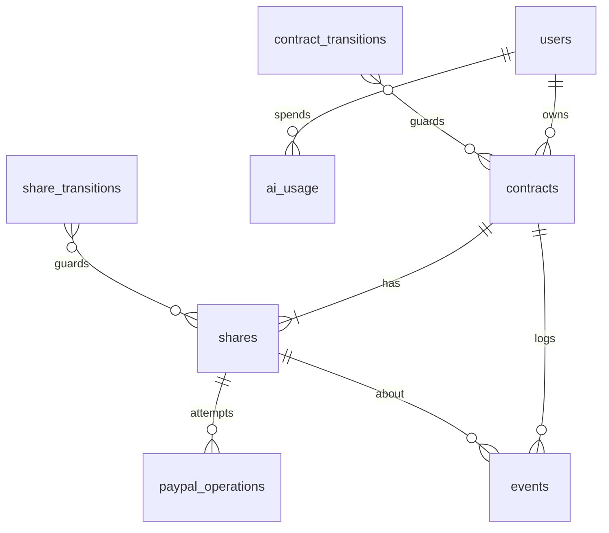

# Data model

PostgreSQL 16, the plain `pg` driver, hand-written SQL. This file is the design. Phase 1 turns it into `backend/migrations/0001_init.sql` (and later numbered files) and reviews it. If code ever needs something not here, update this file first.

## Principles

These go into `backend/docs/principles.md` in phase 1.

1. **Store events, derive aggregates.** Counts such as `held_count` are computed by queries, never stored. The `events` table is append-only.
2. **Constraints live in the schema.** Allowed statuses, allowed transitions, write-once fields, money math, and id formats are CHECKs, FKs, unique indexes, and triggers. Application code may be wrong; the database must refuse.
3. **Idempotency is enforced by UNIQUE indexes**, not by "we checked first."
4. **Volatile state stays out of Postgres.** Rate-limit counters and socket rooms are in memory, behind interfaces.
5. **Every recovery path reads from the database.** Nothing is retried from memory after a restart.
6. **Money is integer cents. Time is `timestamptz`.** Timezones are applied only when presenting (the contract's IANA zone).

## Conventions

- Ids: text with a prefix plus 22 base64url characters (128 random bits): `usr_`, `con_`, `shr_`, `op_`. Generated in the service with `crypto.randomBytes(16).toString("base64url")`. The format is checked by CHECK.
- Statuses: `text` with a CHECK list, not Postgres enums, so adding a value is a one-line migration.
- Every table has `created_at timestamptz NOT NULL DEFAULT now()`. Mutable tables also have `updated_at`, set by trigger.
- `ON DELETE CASCADE` from a user down to their contracts, shares, operations, and events, so deleting a guest removes everything they made.
- Extension: `citext` (case-insensitive email).

## Entity overview



## Tables

### users

```sql
CREATE TABLE users (
  id             text PRIMARY KEY CHECK (id ~ '^usr_[A-Za-z0-9_-]{22}$'),
  kind           text NOT NULL CHECK (kind IN ('member', 'guest')),
  email          citext UNIQUE CHECK (email IS NULL OR char_length(email) <= 254),
  password_hash  text,
  display_name   text NOT NULL CHECK (char_length(display_name) BETWEEN 1 AND 80),
  expires_at     timestamptz,
  created_at     timestamptz NOT NULL DEFAULT now(),
  updated_at     timestamptz NOT NULL DEFAULT now(),
  last_login_at  timestamptz,
  CHECK (
    (kind = 'member' AND email IS NOT NULL AND password_hash IS NOT NULL AND expires_at IS NULL)
    OR
    (kind = 'guest' AND email IS NULL AND password_hash IS NULL AND expires_at IS NOT NULL)
  )
);
CREATE INDEX users_guest_expiry ON users (expires_at) WHERE kind = 'guest';
```

### contracts

```sql
CREATE TABLE contracts (
  id                      text PRIMARY KEY CHECK (id ~ '^con_[A-Za-z0-9_-]{22}$'),
  owner_id                text NOT NULL REFERENCES users(id) ON DELETE CASCADE,
  seed_key                text CHECK (seed_key IN ('cabin-hold', 'print-full')),
  version                 integer NOT NULL DEFAULT 1,
  title                   text CHECK (char_length(title) BETWEEN 1 AND 60),
  rule_text               text NOT NULL CHECK (char_length(rule_text) BETWEEN 1 AND 8000),
  rule_hash               text NOT NULL,                       -- sha256(rule_text || reference_at), for the extraction cache
  reference_at            timestamptz NOT NULL,
  status                  text NOT NULL CHECK (status IN (
                            'extracting','needs_clarification','awaiting_confirmation',
                            'active','grace','capturing','kept','releasing','released','blocked')),
  direction               text CHECK (direction IN ('keep', 'release')),
  money_source            text NOT NULL CHECK (money_source IN ('sample', 'sandbox')),
  currency                text CHECK (currency = 'USD'),
  total_cents             integer CHECK (total_cents > 0),
  share_cents             integer CHECK (share_cents > 0),
  headcount               smallint CHECK (headcount BETWEEN 2 AND 4),
  deadline_at             timestamptz,
  timezone                text,
  grace_person_name       text CHECK (char_length(grace_person_name) BETWEEN 1 AND 80),
  grace_until             timestamptz,
  demo_now                timestamptz,
  clarify_rounds          smallint NOT NULL DEFAULT 0 CHECK (clarify_rounds BETWEEN 0 AND 3),
  clarification_question  text,
  resolution_reason       text,
  extraction              jsonb,
  created_at              timestamptz NOT NULL DEFAULT now(),
  updated_at              timestamptz NOT NULL DEFAULT now(),
  confirmed_at            timestamptz,
  resolved_at             timestamptz,

  UNIQUE (owner_id, seed_key),
  UNIQUE (id, money_source),            -- target of the shares composite FK

  CHECK (total_cents IS NULL OR share_cents IS NULL OR headcount IS NULL
         OR total_cents = headcount * share_cents),
  CHECK ((grace_person_name IS NULL) = (grace_until IS NULL)),
  CHECK (grace_until IS NULL OR deadline_at IS NULL OR grace_until > deadline_at),
  CHECK (status IN ('extracting','needs_clarification','awaiting_confirmation')
         OR (currency IS NOT NULL AND total_cents IS NOT NULL AND share_cents IS NOT NULL
             AND headcount IS NOT NULL AND deadline_at IS NOT NULL AND timezone IS NOT NULL
             AND demo_now IS NOT NULL AND confirmed_at IS NOT NULL AND title IS NOT NULL)),
  CHECK (status NOT IN ('capturing', 'kept')       OR direction = 'keep'),
  CHECK (status NOT IN ('releasing', 'released')   OR direction = 'release'),
  CHECK ((status IN ('kept', 'released')) = (resolved_at IS NOT NULL)),
  CHECK (money_source = 'sandbox' OR seed_key IS NOT NULL)
);
CREATE INDEX contracts_owner ON contracts (owner_id, created_at);
CREATE INDEX contracts_cache ON contracts (rule_hash, created_at) WHERE extraction IS NOT NULL;
```

### shares

```sql
CREATE TABLE shares (
  id                        text PRIMARY KEY CHECK (id ~ '^shr_[A-Za-z0-9_-]{22}$'),
  contract_id               text NOT NULL,
  money_source              text NOT NULL,
  position                  smallint NOT NULL CHECK (position BETWEEN 1 AND 4),
  display_name              text NOT NULL CHECK (char_length(display_name) BETWEEN 1 AND 80),
  is_grace_subject          boolean NOT NULL DEFAULT false,
  status                    text NOT NULL CHECK (status IN (
                              'waiting','checkout_open','authorize_unknown','held','capture_unknown',
                              'kept','capture_failed','void_unknown','released','expired','declined')),
  amount_cents              integer NOT NULL CHECK (amount_cents > 0),
  checkout_attempt          smallint NOT NULL DEFAULT 0 CHECK (checkout_attempt BETWEEN 0 AND 20),
  order_id                  text UNIQUE,
  approve_url               text CHECK (approve_url IS NULL OR approve_url LIKE 'https://www.sandbox.paypal.com/%'),
  authorization_id          text UNIQUE,
  authorization_expires_at  timestamptz,
  capture_id                text UNIQUE,
  sample_label              text,
  created_at                timestamptz NOT NULL DEFAULT now(),
  updated_at                timestamptz NOT NULL DEFAULT now(),

  FOREIGN KEY (contract_id, money_source) REFERENCES contracts (id, money_source) ON DELETE CASCADE,
  UNIQUE (contract_id, display_name),
  UNIQUE (contract_id, position),

  CHECK ((money_source = 'sample') = (sample_label IS NOT NULL)),
  CHECK (money_source = 'sandbox'
         OR (order_id IS NULL AND approve_url IS NULL AND authorization_id IS NULL AND capture_id IS NULL)),
  CHECK (money_source = 'sample'
         OR status NOT IN ('held','capture_unknown','capture_failed','void_unknown','released')
         OR authorization_id IS NOT NULL),
  CHECK (money_source = 'sample' OR status <> 'kept' OR capture_id IS NOT NULL),
  CHECK (status NOT IN ('authorize_unknown') OR money_source = 'sample' OR order_id IS NOT NULL)
);
CREATE UNIQUE INDEX shares_one_grace_subject ON shares (contract_id) WHERE is_grace_subject;
```

The composite foreign key `(contract_id, money_source)` makes "a contract is entirely sample or entirely sandbox" a schema fact, not a convention.

### paypal_operations

One row per mutating attempt and per sync read. This is the audit log and the unknown-outcome record.

```sql
CREATE TABLE paypal_operations (
  id                text PRIMARY KEY CHECK (id ~ '^op_[A-Za-z0-9_-]{22}$'),
  share_id          text NOT NULL REFERENCES shares(id) ON DELETE CASCADE,
  kind              text NOT NULL CHECK (kind IN
                      ('create_order','authorize','capture','void','get_order','get_authorization')),
  idempotency_key   text,
  request           jsonb NOT NULL,           -- method, path, body. Never a token
  response_status   smallint,                 -- null on transport failure
  response          jsonb,                    -- truncated body or {"error": "..."}
  paypal_debug_id   text,
  outcome           text NOT NULL CHECK (outcome IN ('pending','completed','failed','unknown')),
  resolved_by_sync  boolean NOT NULL DEFAULT false,
  created_at        timestamptz NOT NULL DEFAULT now(),
  updated_at        timestamptz NOT NULL DEFAULT now(),
  CHECK ((kind IN ('get_order','get_authorization')) = (idempotency_key IS NULL))
);

-- At most one in-flight mutating PayPal call per share, enforced at insert time.
CREATE UNIQUE INDEX ops_one_inflight_per_share ON paypal_operations (share_id)
  WHERE outcome IN ('pending','unknown') AND kind IN ('create_order','authorize','capture','void');

-- A given idempotency key completes at most once.
CREATE UNIQUE INDEX ops_one_completion_per_key ON paypal_operations (kind, idempotency_key)
  WHERE outcome = 'completed' AND idempotency_key IS NOT NULL;

CREATE INDEX ops_share ON paypal_operations (share_id, created_at);
```

When sync settles an unknown operation, it updates that row's `outcome` to `completed` or `failed` and sets `resolved_by_sync = true`, which frees the in-flight slot. The GET it made is a separate `get_*` row.

### events

Append-only. It feeds the activity feed, the reason panel, the agent's `get_activity` tool, and tests.

```sql
CREATE TABLE events (
  id           bigint GENERATED ALWAYS AS IDENTITY PRIMARY KEY,
  contract_id  text NOT NULL REFERENCES contracts(id) ON DELETE CASCADE,
  share_id     text REFERENCES shares(id) ON DELETE CASCADE,
  type         text NOT NULL CHECK (type IN (
                 'rule_extracted','clarification_requested','clarification_answered','rule_confirmed',
                 'order_created','checkout_declined','hold_placed','hold_unknown','grace_started',
                 'share_expired','capture_completed','capture_unknown','capture_refused',
                 'hold_released','release_unknown','contract_kept','contract_released',
                 'contract_blocked','contract_unblocked','clock_moved','agent_proposal_approved')),
  detail       text NOT NULL CHECK (char_length(detail) <= 500),
  occurred_at  timestamptz NOT NULL,   -- demo_now when the clock caused it, else now()
  created_at   timestamptz NOT NULL DEFAULT now()
);
CREATE INDEX events_contract ON events (contract_id, id DESC);
```

A trigger rejects any `UPDATE` on `events`. Deletes happen only by cascade.

### ai_usage

One row per LLM attempt (fallbacks included), or per cache hit. It backs the daily AI call cap (`ai.md`). It is never deleted by reset.

```sql
CREATE TABLE ai_usage (
  id             bigint GENERATED ALWAYS AS IDENTITY PRIMARY KEY,
  day            date NOT NULL,                          -- UTC
  route          text NOT NULL CHECK (route IN ('extract', 'agent')),
  provider       text NOT NULL CHECK (provider IN ('gemini', 'groq', 'openrouter')),
  model          text NOT NULL,
  user_id        text REFERENCES users(id) ON DELETE SET NULL,
  contract_id    text,                                   -- no FK: contracts may be deleted
  ip_hash        text NOT NULL,                          -- sha256(ip || IP_HASH_SALT)
  input_tokens   integer NOT NULL CHECK (input_tokens >= 0),
  output_tokens  integer NOT NULL CHECK (output_tokens >= 0),
  succeeded      boolean NOT NULL,
  cached         boolean NOT NULL DEFAULT false,
  created_at     timestamptz NOT NULL DEFAULT now(),
  -- the database half of the free-only rule
  CHECK (provider IN ('gemini', 'groq') OR model = 'openrouter/free' OR model LIKE '%:free')
);
CREATE INDEX ai_usage_day ON ai_usage (day);
CREATE INDEX ai_usage_user_day ON ai_usage (user_id, day);
```

The table CHECK is the database half of the free-only rule: an OpenRouter row must be a free model, so even a misconfigured server cannot record paid usage.

### Transition tables and triggers

The allowed state transitions live in lookup tables, seeded in the same migration:

```sql
CREATE TABLE contract_transitions (from_status text, to_status text, PRIMARY KEY (from_status, to_status));
CREATE TABLE share_transitions    (from_status text, to_status text, PRIMARY KEY (from_status, to_status));
```

Contract rows: `extracting→needs_clarification`, `extracting→awaiting_confirmation`, `needs_clarification→extracting`, `awaiting_confirmation→active`, `active→grace|capturing|releasing|blocked`, `grace→capturing|releasing|blocked`, `capturing→kept|blocked`, `releasing→released|blocked`, `blocked→active|grace|capturing|releasing`.

Share rows: `waiting→checkout_open|expired`, `checkout_open→waiting|authorize_unknown|held|declined|expired`, `authorize_unknown→held|checkout_open|declined`, `declined→checkout_open|expired`, `held→capture_unknown|kept|capture_failed|void_unknown|released`, `capture_unknown→kept|held`, `void_unknown→released|held`.

Triggers (PL/pgSQL, in `0001_init.sql`):

| Trigger | Table | Rule |
|---|---|---|
| `touch_updated_at` | users, contracts, shares, paypal_operations | sets `updated_at = now()` |
| `contracts_guard` | contracts, BEFORE UPDATE | a status change must exist in `contract_transitions`; `direction` is write-once; once `confirmed_at` is set, `total_cents`, `share_cents`, `headcount`, `deadline_at`, `timezone`, `grace_person_name`, `grace_until`, `money_source`, and `owner_id` are immutable; `version = OLD.version + 1` |
| `shares_guard` | shares, BEFORE UPDATE | a status change must exist in `share_transitions`; `amount_cents`, `display_name`, `money_source`, `contract_id`, and `is_grace_subject` are immutable; `authorization_id` and `capture_id` are write-once |
| `shares_amount_matches` | shares, BEFORE INSERT | `amount_cents` equals the parent contract's `share_cents` |
| `events_append_only` | events, BEFORE UPDATE | always raises |

Each trigger raises with SQLSTATE `23514` (check violation) and a clear message. The repository maps that to `500 internal` and logs it at error level, because it means a bug got past the services.

## Read-model queries (derived aggregates)

```sql
-- held/kept/released counts per contract
SELECT contract_id,
       count(*) FILTER (WHERE status = 'held')     AS held_count,
       count(*) FILTER (WHERE status = 'kept')     AS kept_count,
       count(*) FILTER (WHERE status = 'released') AS released_count
FROM shares WHERE contract_id = ANY($1) GROUP BY contract_id;
```

`version` on contracts is bumped by trigger on every update and sent in socket invalidations, so clients can ignore stale events.

## Seeds (per user)

`services/seed` inserts both sample contracts for one user. It runs when a guest is created, when a member signs up, and on that user's reset. Rule text comes from `src/shared/rules.ts`. Every share has `money_source = 'sample'` and `sample_label = 'Sample — no PayPal hold'`. Both contracts have `reference_at = 2026-11-01T12:00:00-08:00` and `confirmed_at = 2026-11-01T12:00:00-08:00`.

**`cabin-hold`.** Title `Cabin weekend`. Status `active`. USD, 32000 / 8000 / 4. Deadline `2026-11-06T18:00:00-08:00`, timezone `America/Los_Angeles`. Grace Maya Shah until `2026-11-09T18:00:00-08:00`. `demo_now` `2026-11-06T16:00:00-08:00`.

| Position | Name | Status | Grace |
|---|---|---|---|
| 1 | Alex Chen | `held` | false |
| 2 | Sam Ortiz | `held` | false |
| 3 | Jordan Lee | `held` | false |
| 4 | Maya Shah | `waiting` | true |

**`print-full`.** Title `Print run`. Status `active`. USD, 20000 / 5000 / 4. Deadline `2026-11-06T18:00:00-08:00`, no grace. `demo_now` `2026-11-06T16:00:00-08:00`. Shares, all `held`: Priya Nair, Noah Brooks, Elena Vaz, Chris Dalton.

Seed rows are inserted directly in their starting statuses. The transition triggers check updates only.

## Reset

`POST /api/demo/reset` (authenticated) deletes the caller's contracts (shares, operations, and events cascade), then re-inserts that caller's two seeds, in one transaction. It never touches other users' data, never touches `ai_usage`, and never calls PayPal.

## Guest cleanup

On boot and every 6 hours: `DELETE FROM users WHERE kind = 'guest' AND expires_at < now()`. Cascades remove their data. Their `ai_usage` rows remain with a null `user_id`.

## Migrations

- Files: `backend/migrations/NNNN_name.sql`, forward-only, each run inside a transaction.
- `scripts/migrate.ts` keeps `schema_migrations(version text PRIMARY KEY, name text, checksum text, applied_at timestamptz)`.
  - `migrate` applies pending files in order.
  - `status` lists applied and pending migrations.
  - `reset` drops and recreates the schema, and refuses when `NODE_ENV=production`.
- An edited, already-applied file (checksum mismatch) fails `migrate` and `/health/ready`.
- In production, a one-shot `migrate` container runs before `backend` starts (see `deploy.md`).
